# genOS

[](AGENTS.md)
[](https://github.com/verdenef/genOS/commits/main)
[](guides/guide.md#tool-setup-bootstrapping)
[](profiles/README.md)
[](guides/guide.md#obsidian-integration)
[](LICENSE)

**genOS** is a universal, stack-agnostic AI operating system for modern software development: a lightweight, deterministic **Project Brain** that maintains persistent memory across AI agents, chat sessions, and IDEs.

Humans provide intent and approvals. AI maintains the brain. Source code and live runtimes hold implementation truth. genOS stores the architectural and execution knowledge that cannot be inferred from code alone.

---

## The Unified AI Engineering Stack

genOS coordinates five complementary disciplines into one frictionless developer workflow:

| Layer | System | Responsibility |
|:---|:---|:---|
| **1. Memory & State** | **genOS** | Project Brain (`brain/`), zero-history recovery, milestone tracking, and mandatory Sanity Gates. |
| **2. Specialist Identity** | **Agency Agents** | Domain engineering rules (e.g. `unity-architect`, `backend-architect`) verified via the Hard Persona Gate before planning. Auto-installed via `guides/scripts/install_agent.py` upon human approval (no desktop app required). |
| **3. Code Topology *(Optional)*** | **Graphify** | Local, offline `--code-only` Tree-sitter AST call graphs (`graphifyy[mcp]`) for instant caller/callee queries and path analysis. |
| **4. Senior Restraint** | **Ponytail** | The Ladder of Restraint (YAGNI, reuse, stdlib, 1-liner) prunes over-engineering before writing code. |
| **5. Execution Rigor** | **Superpowers** | Test-driven development, subagent-driven task plans, copy-paste handoffs, and verification before completion. |

---

## Architecture Overview

```mermaid
flowchart TD

subgraph group_workflow["Developer Workflow"]
  node_kickoff["Kickoff<br/>[SKILL.md]"]
  node_batch["Batch<br/>[workflow-batch.md]"]
  node_shutdown["Shutdown<br/>[SKILL.md]"]
  node_status["Status<br/>[AGENTS.md]"]
end

subgraph group_brain["Project Brain"]
  node_projectbrain[("Project Brain")]
  node_templates["Brain Templates"]
end

subgraph group_extensions["Specialist Extensions"]
  node_specialists["Agency Agents<br/>[agency_agents.md]"]
  node_installer["Agent Installer<br/>[install_agent.py]"]
  node_idefiles["IDE Skills & Rules<br/>[.agents / .cursor]"]
  node_graphify["Graphify Topology<br/>[mcp-graphify.json]"]
  node_ponytail["Ponytail Restraint<br/>[SKILL.md]"]
  node_profiles["Stack Profiles"]
end

subgraph group_maintenance["Maintenance"]
  node_doctor["Doctor<br/>[SKILL.md]"]
  node_update["Update<br/>[SKILL.md]"]
end

node_developer(("Developer"))

node_developer -->|"starts session"| node_kickoff
node_kickoff -->|"boots from"| node_projectbrain
node_kickoff -->|"verifies rules"| node_specialists
node_kickoff -.->|"checks optionally"| node_graphify
node_kickoff -->|"applies filter"| node_ponytail
node_kickoff -->|"proposes handoff"| node_developer
node_developer -->|"starts execution"| node_batch
node_batch -->|"coordinates work"| node_projectbrain
node_developer -->|"closes session"| node_shutdown
node_shutdown -->|"persists progress"| node_projectbrain
node_templates -->|"initializes"| node_projectbrain
node_developer -->|"approves & installs"| node_installer
node_installer -->|"fetches personas"| node_specialists
node_installer -->|"writes skill/rule files"| node_idefiles
node_developer -->|"requests summary"| node_status
node_status -->|"reads progress"| node_projectbrain
node_developer -->|"requests diagnosis"| node_doctor
node_doctor -->|"repairs integrity"| node_projectbrain
node_developer -->|"requests upgrade"| node_update
node_update -->|"verifies drift & runs"| node_doctor
node_kickoff -.->|"uses guidance"| node_profiles

click node_kickoff "https://github.com/verdenef/genOS/blob/main/.agents/skills/genos-kickoff/SKILL.md"
click node_batch "https://github.com/verdenef/genOS/blob/main/guides/prompts/workflow-batch.md"
click node_shutdown "https://github.com/verdenef/genOS/blob/main/.agents/skills/genos-shutdown/SKILL.md"
click node_status "https://github.com/verdenef/genOS/blob/main/AGENTS.md"
click node_projectbrain "https://github.com/verdenef/genOS/tree/main/brain"
click node_templates "https://github.com/verdenef/genOS/tree/main/templates/brain"
click node_specialists "https://github.com/verdenef/genOS/blob/main/integrations/agency_agents.md"
click node_installer "https://github.com/verdenef/genOS/blob/main/guides/scripts/install_agent.py"
click node_idefiles "https://github.com/verdenef/genOS/tree/main/.agents/skills"
click node_graphify "https://github.com/verdenef/genOS/blob/main/profiles/templates/mcp-graphify.json"
click node_ponytail "https://github.com/verdenef/genOS/blob/main/.agents/skills/ponytail/SKILL.md"
click node_profiles "https://github.com/verdenef/genOS/tree/main/profiles"
click node_doctor "https://github.com/verdenef/genOS/blob/main/.agents/skills/genos-doctor/SKILL.md"
click node_update "https://github.com/verdenef/genOS/blob/main/.agents/skills/genos-update/SKILL.md"

classDef toneBlue fill:#dbeafe,stroke:#2563eb,stroke-width:1.5px,color:#172554
classDef toneAmber fill:#fef3c7,stroke:#d97706,stroke-width:1.5px,color:#78350f
classDef toneMint fill:#dcfce7,stroke:#16a34a,stroke-width:1.5px,color:#14532d
classDef toneRose fill:#ffe4e6,stroke:#e11d48,stroke-width:1.5px,color:#881337
classDef toneIndigo fill:#e0e7ff,stroke:#4f46e5,stroke-width:1.5px,color:#312e81
class node_kickoff,node_batch,node_shutdown,node_status toneBlue
class node_projectbrain,node_templates toneAmber
class node_specialists,node_installer,node_idefiles,node_graphify,node_ponytail,node_profiles toneMint
class node_doctor,node_update toneRose
class node_developer toneIndigo
```



---

## Daily Commands

genOS eliminates prompt boilerplate. In any AI chat (Antigravity, Cursor, Claude Code, Claude Desktop, Codex), just type:

| Command | Action |
|:---|:---|
| `kickoff` | BOOTs from brain, verifies specialist rules, runs optional Graphify topology check, applies Ponytail filter, and proposes a plan + Model Tier recommendation + copy-pasteable execution handoff blocks. |
| `kickoff <intent>` | Scoped session — e.g. `kickoff fix the login flow` or `kickoff execute the approved plan: <path>`. |
| `shutdown` | Verifies milestone criteria, runs the mandatory Sanity Gate, and persists cold-start execution RAM. |
| `doctor` | Diagnoses and auto-repairs brain integrity issues. |
| `status` | Quick read-only summary of current milestone and execution RAM. |
| `batch` | Autonomous multi-task execution with dual-persona (Builder + QA Auditor) loops. |
| `update` | Verifies drift against GitHub `main` (stops if current), proposes an Upgrade & Migration Plan for approval, refreshes core framework files while strictly shielding `brain/`, `.obsidian/`, custom profiles, and project-installed agent skills/rules, then runs Doctor. |

### Timeless Model Tiers
genOS recommends models by capability tier rather than hardcoded version strings:
- **Flagship** (`kickoff` planning, `batch`, complex architecture) — start in a **new session**.
- **Balanced** (daily implementation, tweaks, debugging) — continue only if context is clean.
- **Fast** (`shutdown`, `doctor`, `status`) — minimal token overhead.

---

## Repository Structure

```
genOS/
├── AGENTS.md                        # Universal kernel — authoritative operational rules
├── CLAUDE.md                        # Claude Code entry point (points to AGENTS.md)
├── LICENSE                          # MIT License for genOS
├── README.md                        # Repository overview (this file)
├── THIRD_PARTY_NOTICES.md           # Upstream open-source attributions & licenses
├── .agents/skills/                  # On-demand skills (Superpowers, Ponytail, Graphify, genOS commands)
├── .cursor/rules/                   # Cursor IDE rules (genos, ponytail, graphify, Agency Agents)
├── brain/                           # Self-hosted Project Brain tracking genOS itself
│   ├── 00_PROJECT.md                # Intent, scope, architecture constraints
│   ├── 20_PROGRESS.yaml             # Cold-start execution RAM
│   ├── 30_DECISIONS.md              # Architectural Decision Records (ADRs)
│   ├── 40_BACKLOG.md                # Kanban queue for non-milestone work
│   ├── 50_ROADMAP.md                # Milestone definitions and criteria
│   ├── 60_AGENTS.md                 # Approved AI workforce roster
│   └── systems/                     # Modular system documents
├── templates/brain/                 # Pristine (_TBD_) starter Brain templates for new projects
├── profiles/                        # Stack profiles + profiles/templates/mcp-graphify.json
├── guides/                          # User guide (guide.md), workflow prompts, and plans
│   └── scripts/                     # Framework scripts (install_agent.py: Agency Agents auto-installer)
├── docs/superpowers/                # Design specifications and implementation plans
└── integrations/                    # Optional integrations (agency_agents.md)
```

---

## Quickstart

### Day 0: Install Into a New Project

#### Option A: 1-Prompt Auto-Install *(Recommended — Claude Code, Cursor, Antigravity, Codex)*
Open your project in an AI IDE/CLI with terminal access and paste:
```text
Install genOS into a `genOS/` subfolder in this repository from https://github.com/verdenef/genOS/archive/refs/heads/main.zip (using a temporary `_genOS_Temp/` folder, then deleting it after):
1. Copy `AGENTS.md`, `guides/`, `profiles/`, `integrations/`, `templates/`, and `README.md` into `genOS/`.
2. Initialize `genOS/brain/` from `templates/brain/` (do NOT copy the upstream repo's self-hosted `brain/`, `docs/superpowers/`, or `scratch/`).
3. Merge `.agents/` and `.cursor/` into the repository root, and create/append root `CLAUDE.md` so it points to `genOS/AGENTS.md` (preserving any existing files/rules in this repo).
4. Once installed, read `genOS/AGENTS.md` and begin Day 0 setup following `genOS/guides/prompts/setup-init.md`.
```

#### Option B: Manual Download *(for sandboxed or offline setups)*
1. Download or clone `verdenef/genOS` into your repository (either at root or inside a `genOS/` subfolder).
2. Because `brain/` in this upstream repo tracks **genOS itself**, initialize your project's `brain/` directory from [`templates/brain/`](templates/brain/) (or let `setup-init.md` reset it for you).
3. If installing inside a subfolder like `genOS/`: keep `.agents/`, `.cursor/`, and a root `CLAUDE.md` pointing to `genOS/AGENTS.md` at your repo root so Claude Code and Cursor auto-detect them.
4. Open your AI chat and paste [`guides/prompts/setup-init.md`](guides/prompts/setup-init.md).

### Day 1+: Daily Workflow
1. Open a fresh chat and type **`kickoff`**.
2. Review the plan, then copy-paste the generated execution command block into a new session.
3. When done, type **`shutdown`**.

### Upgrading an Existing Project (`v1`, `v2`, or `v3`)
Run **`update`** in chat (or paste [`guides/prompts/update.md`](guides/prompts/update.md) and point to an older `v1`/`v2` `genOS` folder). genOS fetches `main` read-only, verifies whether your files are outdated (stopping cleanly if already up to date, with a tip if an existing codebase lacks Graphify), shows an Upgrade & Migration Plan for approval (including optional codebase-aware Graphify setup), refreshes core files while strictly shielding `brain/`, `.obsidian/`, custom profiles, project-installed Agency Agents, and source code, and runs `doctor`.

### Optional: Local Code Topology with Graphify
If you work on large codebases, install Graphify locally (powered by PyPI [`graphifyy`](https://pypi.org/project/graphifyy/)). Both Day 0 setup (`setup-init.md`) and framework upgrade (`update` / `kickoff tooling`) detect existing coding codebases and offer approval-gated configuration:
```bash
uv tool install "graphifyy[mcp]"
graphify extract . --code-only
```
Then ignore `graphify-out/` in `.gitignore`, scope code folders in `.graphifyignore`, and register `graphify-mcp --graph graphify-out/graph.json` from [`profiles/templates/mcp-graphify.json`](profiles/templates/mcp-graphify.json). When unconfigured, genOS agents silently fall back to standard text search.

For the full walkthrough, see the [genOS User Guide](guides/guide.md).  
**For AI agents:** Read and follow [`AGENTS.md`](AGENTS.md).

---

## Core Principles

1. **Zero-Chat-History Recovery:** Agents recover state from the Project Brain alone. No token degradation or context rot.
2. **Deterministic Ownership:** Every piece of project truth has exactly one authoritative file.
3. **Automated Sanity Gates:** Mandatory integrity audits guarantee the Brain is never corrupted.
4. **Local-Only Code Topology:** Graphify AST parsing uses `--code-only` offline without sending code to external LLMs, paired with Grep checks for runtime strings and scene/prefab refs.
5. **On-Disk Skills:** Skills in `.agents/skills/` are read dynamically from disk during `kickoff`—no manual UI settings uploads required.
6. **Zero-App Workforce Automation:** Specialist Agency Agents from `msitarzewski/agency-agents` install directly via `guides/scripts/install_agent.py` upon human approval—requiring only Python 3 stdlib, with zero external tools or desktop apps.

---

## Acknowledgments & Third-Party Licenses

genOS integrates and builds upon these open-source projects:

- **[Superpowers (`obra/superpowers`)](https://github.com/obra/superpowers)** by Jesse Vincent *(MIT License)* — Structured ideation, test-driven execution plans, subagent-driven workflows, and verification gates.
- **[Ponytail (`DietrichGebert/ponytail`)](https://github.com/DietrichGebert/ponytail)** by DietrichGebert *(MIT License)* — The Ladder of Restraint preventing over-engineering and unnecessary code bloat.
- **[Agency Agents (`msitarzewski/agency-agents`)](https://github.com/msitarzewski/agency-agents)** by AgentLand Contributors *(MIT License)* — Specialist domain agent personas fetched on demand via `guides/scripts/install_agent.py`.
- **[Graphify (`Graphify-Labs/graphify`)](https://github.com/Graphify-Labs/graphify)** *(Apache-2.0)* — Local, offline `--code-only` Tree-sitter AST knowledge graphs and MCP tooling (`graphifyy`).

Full license texts and copyright notices are preserved in [`THIRD_PARTY_NOTICES.md`](THIRD_PARTY_NOTICES.md).

---

## License

genOS is released under the [MIT License](LICENSE).
