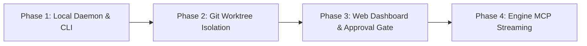

# genOS Virtual Office — Future Vision (Full Custom Platform)

**Date:** 2026-10-10  
**Status:** Deferred / Research Backlog (Future Vision)  
**Approach:** Full Custom Build — Dedicated local/cloud multi-agent orchestrator with engine streaming, visual dashboard, and native genOS brain integration  

---

## 1. Overview & Vision

While the **Hybrid Approach** ([`2026-10-10-virtual-office-hybrid-design.md`](file:///d:/GameOS/docs/superpowers/specs/2026-10-10-virtual-office-hybrid-design.md)) leverages existing mobile apps (Grok Bot) for immediate, low-friction adoption, the **Future Vision** is a purpose-built, self-hosted autonomous software agency platform designed specifically around the genOS kernel.

The ultimate goal is a **"Virtual Development Studio"**: an always-on control plane where specialist AI agents autonomously pick up tasks from the Project Brain, execute code in local or sandboxed environments, inspect game viewports (e.g., Unity, Godot) via streaming MCPs, peer-review each other's work, and queue finished deliverables for human approval.

---

## 2. Why Build From Scratch? (Limitations Solved)

| Hybrid Limitation (Grok Bot) | Full Custom Virtual Office Solution |
| :--- | :--- |
| **No local editor/engine visibility** (cloud bots cannot see Unity) | **Local Agent Daemon** with native MCP connectivity, live viewport capture, and game runtime inspection. |
| **Third-party UI dependency** (must use Grok Bot app) | **Dedicated Studio Dashboard** (web/desktop) showing visual agent desks, task queues, and visual diff reviews. |
| **External API / cloud cost locking** | **Hybrid Model Router** supporting local models (Ollama, vLLM) for routine tasks and frontier models (Claude, GPT, Grok) for architecture. |
| **Manual git PR management for approvals** | **Integrated One-Click Approval Gate** with interactive visual diffs, rollback buttons, and instant merge automation. |
| **Platform messaging constraints** (thread noise, rate limits) | **High-speed Local Event Mesh** (WebSockets/gRPC) for agent-to-agent negotiations and subagent dispatching. |

---

## 3. System Architecture

```
┌────────────────────────────────────────────────────────────────────────┐
│                   Virtual Studio Dashboard (Web / Desktop)             │
│  ┌─────────────────────────┐  ┌─────────────────┐  ┌────────────────┐  │
│  │   Studio Office View    │  │  Approval Gate  │  │  Live Telemetry│  │
│  │ (Agent status & desks)  │  │ (Diffs & Viewport)│ │ (Tokens/Logs)  │  │
│  └─────────────────────────┘  └─────────────────┘  └────────────────┘  │
└───────────────────────────────────▲────────────────────────────────────┘
                                    │ WebSockets / REST
┌───────────────────────────────────▼────────────────────────────────────┐
│                    Studio Orchestrator Core (Daemon)                   │
│                                                                        │
│  ┌─────────────────┐   ┌───────────────────┐   ┌───────────────────┐   │
│  │  Lead Agent     │   │ Event Broker      │   │ Model Router      │   │
│  │  Scheduler      │   │ (Agent IPC Mesh)  │   │ (Local + Cloud)   │   │
│  └────────┬────────┘   └─────────┬─────────┘   └─────────┬─────────┘   │
└───────────┼──────────────────────┼───────────────────────┼─────────────┘
            │                      │                       │
┌───────────▼──────────────────────▼───────────────────────▼─────────────┐
│                       Autonomous Worker Runtimes                       │
│                                                                        │
│   ┌────────────────────┐   ┌────────────────────┐   ┌──────────────┐   │
│   │   Builder Agent    │   │      QA Agent      │   │ Engine/Tool  │   │
│   │  (Isolated Worktree│   │ (Adversarial Audit │   │ MCP Server   │   │
│   │   or Sandbox)      │   │   & Playwright)    │   │ (Unity/Web)  │   │
│   └─────────┬──────────┘   └─────────┬──────────┘   └───────┬──────┘   │
└─────────────┼────────────────────────┼──────────────────────┼──────────┘
              ▼                        ▼                      ▼
┌────────────────────────────────────────────────────────────────────────┐
│                        Local Storage & Hardware                        │
│  ┌─────────────────────────────────┐  ┌─────────────────────────────┐  │
│  │  genOS Brain (Obsidian Vault)   │  │ Local Unity / Node Project  │  │
│  └─────────────────────────────────┘  └─────────────────────────────┘  │
└────────────────────────────────────────────────────────────────────────┘
```

---

## 4. Core Subsystems

### 4.1. Studio Orchestrator Core
- **Roadmap Parser:** Continuously monitors `brain/50_ROADMAP.md` and `brain/40_BACKLOG.md` for task readiness and dependency unblocking.
- **Agent Lifecycle Manager:** Spawns, monitors, pauses, or terminates agent worker threads.
- **Git Worktree Manager:** Automatically creates isolated git worktrees (`.worktrees/agent-<name>`) so multiple agents work concurrently without file-lock collisions.

### 4.2. Local Tooling & Engine Bridge
- **Engine Viewport Streaming:** Interfaces with Unity MCP (or Godot/Web equivalent) to take frame captures, read console logs, and inspect runtime object hierarchies.
- **Verification Harness:** Automatically runs unit tests, static analysis, and game test play sessions before handoff to human review.

### 4.3. High-Fidelity Approval Gate
- **Interactive Review UI:** Displays side-by-side git diffs of both source code and `brain/` files.
- **Visual Artifact Inspection:** Embeds screenshots taken by QA agents directly in the approval card (e.g. "Hitbox collision test passed; see screenshot").
- **One-Click Action:** "Approve & Merge to Main" runs the mandatory genOS Sanity Gate, merges the worktree branch, updates `20_PROGRESS.yaml`, and signals Obsidian.

### 4.4. Flexible Model Router
- **Tier 1 (Sanity & Formatting):** Small local models (e.g. Qwen 2.5 Coder 7B, Llama 3.2) handle index synchronization, YAML linting, and repetitive syntax tasks for $0 cost.
- **Tier 2 (Code & QA):** Fast frontier models (Gemini Flash, Claude Sonnet) handle implementation and test generation.
- **Tier 3 (Lead Architect):** Frontier reasoning models (Claude Opus, OpenAI o-series) handle roadmapping, architectural dispute resolution, and cross-system design.

---

## 5. Daily Autonomous Workflow (Future State)

1. **Morning Kickoff (Automatic or Scheduled):**
   - The Orchestrator wakes up according to user schedule or trigger.
   - Lead Agent reads `brain/50_ROADMAP.md` and generates a prioritized Daily Plan with token cost estimates.
   - Push notification sent to user's phone / desktop: *"Ready to execute Milestone 6.2 with 2 Builder bots and 1 QA bot. Tap to start."*

2. **Parallel Agent Execution:**
   - Builder Agent spins up an isolated git worktree, runs the genOS BOOT sequence, and implements features.
   - Builder interacts with Unity runtime via MCP, triggering game state changes and taking screenshots.
   - QA Agent checks out the completed branch, executes regression tests, verifies acceptance criteria, and appends a verification verdict.

3. **Human Sign-Off:**
   - Human opens Studio Dashboard, reviews the generated pull request, checks screenshots/test videos, and clicks **Approve**.
   - Orchestrator runs SHUTDOWN sequence, merges to `main`, auto-deletes the temporary worktree, and triggers Obsidian vault sync.

---

## 6. Phased Implementation Roadmap

When the time comes to build this from scratch, it should be tackled in 4 manageable phases:



- **Phase 1: Local Daemon & CLI (`genos-studio`)**
  - Background daemon written in Node.js or Go that monitors `brain/` and coordinates agent subprocesses via CLI.
- **Phase 2: Git Worktree Orchestration**
  - Multi-agent concurrency without file collisions; automated branch cleanup and PR generation.
- **Phase 3: Web UI Dashboard**
  - Sleek modern UI (Vite + Vanilla CSS / React) for viewing active agents, chat logs, and one-click approvals.
- **Phase 4: Game Engine Streaming & Multi-Model Mesh**
  - Unity MCP live screenshot stream in the dashboard; local LLM fallback via Ollama.

---

## 7. Relationship to Current genOS Projects

- **100% Backward Compatible:** Because the genOS Project Brain (`00_PROJECT.md`, `50_ROADMAP.md`, `20_PROGRESS.yaml`) is the single source of truth, switching from the Hybrid (Grok Bot) model to this custom platform requires **zero changes** to your project's Brain or code.
- **Immediate Next Step:** Use the **Hybrid Model** ([`2026-10-10-virtual-office-hybrid-design.md`](file:///d:/GameOS/docs/superpowers/specs/2026-10-10-virtual-office-hybrid-design.md)) today to get the immediate benefits of automated daily workflows without sinking weeks into custom infrastructure. Keep this document as the blueprint when you are ready to scale up.
