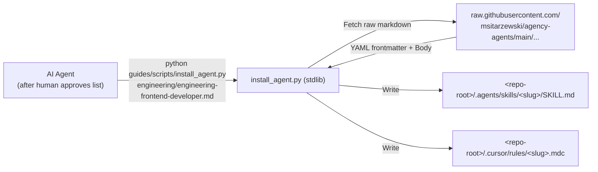

# Agency Agents Auto-Installer & Clean Core Design

> **Document:** `docs/superpowers/specs/2026-11-10-agency-agents-auto-installer-design.md`  
> **Author:** Antigravity & User  
> **Date:** 2026-11-10  
> **Status:** Design Review  
> **Associated Milestone:** `M2` (genOS v3 Ergonomics, Superpowers Integration & Self-Hosting)

---

## 1. Executive Summary

Previously, onboarding a new project with genOS required users to manually download and run the third-party **Agency Agents desktop application** and manually import/convert agent personas into `.cursor/rules/` and `.agents/skills/`. Furthermore, `d:\GameOS\.cursor\rules\` still carried 14 Baybayin-specific Unity/thesis `.mdc` files without `.agents/skills/` counterparts, polluting non-game projects when copied or updated.

This design eliminates manual Agency desktop app installation entirely:
1. **Clean Core Repository:** Keep only core framework rules/skills (`genos*`, `ponytail`, `graphify`, and Superpowers) pre-bundled in genOS. Remove project-specific Agency Agent leftovers from `d:\GameOS\.cursor\rules/`.
2. **Fetch & Install After Human Approval:** During Day 0 setup (`setup-init.md`) or `kickoff workforce`, the AI recommends agents from `profiles/<stack>/profile.yaml` or the live `msitarzewski/agency-agents` catalog, waits for human approval, and automatically installs approved agents verbatim into **both** `.agents/skills/<slug>/SKILL.md` and `.cursor/rules/<slug>.mdc` via a tiny stdlib Python utility.
3. **Update Shielding:** Protect project-installed Agency Agents from being modified or wiped during `update`.

---

## 2. Architectural Principles & Boundaries

1. **Approval Before Installation:** Agents still audit the project (`00_PROJECT.md`, `50_ROADMAP.md`, `30_DECISIONS.md`) and get explicit human approval of the recommended roster before installing files.
2. **Zero External Dependencies:** The installer (`guides/scripts/install_agent.py`) uses Python 3 standard library only (`urllib.request`, `json`, `re`, `pathlib`, `argparse`). No third-party packages, desktop apps, or API keys are required.
3. **Verbatim Dual-Target Output:** Upstream markdown from `https://raw.githubusercontent.com/msitarzewski/agency-agents/main/<id>` is copied verbatim (never summarized or paraphrased by an LLM) into both IDE skill/rule formats.
4. **Core vs. Project Rule Separation:**
   - **Core genOS rules/skills** (shipped in `verdenef/genOS`): `genos`, `genos-kickoff`, `genos-shutdown`, `genos-doctor`, `genos-update`, `ponytail`, `graphify`, and Superpowers skills.
   - **Project Agency Agents** (installed per-repo in `.agents/skills/<slug>/SKILL.md` and `.cursor/rules/<slug>.mdc`): Owned by the project repository and strictly preserved by `update`.

---

## 3. Clean Core Cleanup (Removing Baybayin Leftovers)

Remove the 14 project-specific `.mdc` files from `d:\GameOS\.cursor\rules/`:
- `academic-historian.mdc`, `academic-statistician.mdc`, `design-ux-researcher.mdc`
- `engineering-minimal-change-engineer.mdc`, `engineering-mobile-release-engineer.mdc`, `engineering-technical-writer.mdc`
- `game-audio-engineer.mdc`, `game-designer.mdc`, `level-designer.mdc`, `narrative-designer.mdc`, `unity-architect.mdc`
- `marketing-app-store-optimizer.mdc`
- `testing-accessibility-auditor.mdc`, `testing-reality-checker.mdc`

Update `AGENTS.md` (Framework Update Protocol) and `guides/prompts/update.md` so upgrades refresh core genOS skills/rules only and never delete or overwrite project-installed Agency Agents.

---

## 4. Stdlib Auto-Installer: `guides/scripts/install_agent.py`



### Interface & CLI Specification

1. **Installing one or more agents:**
   ```bash
   python <genos>/guides/scripts/install_agent.py <agent_ref_1> [<agent_ref_2> ...] [--root <repo_root>] [--force]
   ```
   - Accepts any of:
     - Profile `id`: `engineering/engineering-frontend-developer.md`
     - GitHub `blob/main` URL: `https://github.com/msitarzewski/agency-agents/blob/main/game-development/game-designer.md`
     - Raw GitHub URL: `https://raw.githubusercontent.com/msitarzewski/agency-agents/main/...`
     - Optional suffix `.md` omitted or included (normalized cleanly).
   - **Slug Derivation:** Filename stem (e.g., `engineering-frontend-developer`, `game-designer`), sanitized to lowercase `[a-z0-9-]`.
   - **Target Directory Discovery (`--root` fallback):** If `--root` is omitted, walks upward from the script's directory to detect whether genOS lives inside a `genOS/` subfolder or at repo root (detecting `.git/`, or parent of `genOS/`), ensuring files always land at `<repo-root>/.agents/skills/` and `<repo-root>/.cursor/rules/`.

2. **Frontmatter & Output Conversion:**
   Upstream files carry frontmatter (`name`, `description`, `color`, `emoji`, `vibe`) followed by the persona body.
   - Extract `description` (and fallback cleanly to `"Specialist agent persona imported from msitarzewski/agency-agents"` if absent), safely YAML-quoted (`json.dumps` / double-quoted scalar if needed).
   - **`.agents/skills/<slug>/SKILL.md`:**
     ```markdown
     ---
     name: <slug>
     description: "<escaped description>"
     ---

     <verbatim upstream markdown body>
     ```
   - **`.cursor/rules/<slug>.mdc`:**
     ```markdown
     ---
     description: "<escaped description>"
     globs: ""
     alwaysApply: false
     ---

     <verbatim upstream markdown body>
     ```

3. **Catalog Discovery (`--list [query]`):**
   ```bash
   python <genos>/guides/scripts/install_agent.py --list [keyword]
   ```
   Queries `https://api.github.com/repos/msitarzewski/agency-agents/git/trees/main?recursive=1`, filters `.md` agent paths outside repo meta-docs (`README.md`, `CONTRIBUTING.md`, etc.), and prints matching `<category>/<slug>.md` IDs so `kickoff workforce` can discover specialists beyond `profile.yaml` defaults without opening a browser or external app.

4. **Idempotency & Safe Failures:**
   - Existing files are skipped cleanly unless `--force` is passed (never silently clobbering human customizations).
   - Network failures, HTTP 404s, or invalid inputs print the failing URL/error to `stderr`, write zero partial files, and exit non-zero so the agent can report or manually resolve.

---

## 5. Protocol & Documentation Updates

1. **`integrations/agency_agents.md`:**
   - Replace steps 5–6 (*"Wait for human to manually install"*) with:
     - Present recommendations → Wait for human approval → Execute `install_agent.py` for approved agents → Verify files in `.agents/skills/` and `.cursor/rules/` → Record in `brain/60_AGENTS.md` (and note manual URL fallback only if offline/no Python).
2. **`guides/prompts/setup-init.md` (Phase 3):**
   - Present the profile's `recommended_agents` (plus any custom needs from `00_PROJECT.md`), get confirmation, install automatically via `install_agent.py`, and record in `brain/60_AGENTS.md`.
3. **`AGENTS.md` & `guides/prompts/update.md`:**
   - Document core-only skill/rule refreshes on `update` (explicitly shielding project-installed Agency Agents).
   - Document `install_agent.py` usage in `AGENTS.md` -> Optional Integrations / `kickoff workforce`.
4. **`README.md` & `guides/guide.md`:**
   - Note zero-app automatic installation of Agency Agents in the stack description and structure tree (`guides/scripts/install_agent.py`).

---

## 6. Verification & Acceptance Criteria

1. **Automated Unit Tests (`guides/scripts/test_install_agent.py`):**
   - Offline `unittest` suite using mocked HTTP (`unittest.mock`) verifying:
     - Input normalization (`id`, `blob/main`, `raw`, optional `.md`).
     - Dual output (`SKILL.md` + `.mdc`) with intact verbatim body and valid escaped YAML frontmatter (colons, quotes).
     - Automatic repo-root detection both when `genOS` is standalone and inside a `genOS/` subdirectory.
     - Existing file preservation unless `--force` is given.
     - Atomic/clean failure on HTTP errors (no partial files written).
     - `--list` catalog filtering.
2. **Live Integration Verification:**
   - Verify `--list` and a live fetch test into a temporary directory using an actual URL from `profiles/web-fullstack/profile.yaml`.
3. **Clean Core & Doctor Audit:**
   - Confirm only core genOS `.mdc` files remain in `d:\GameOS\.cursor\rules/`.
   - Run the genOS Doctor check (`8/8` pass).
