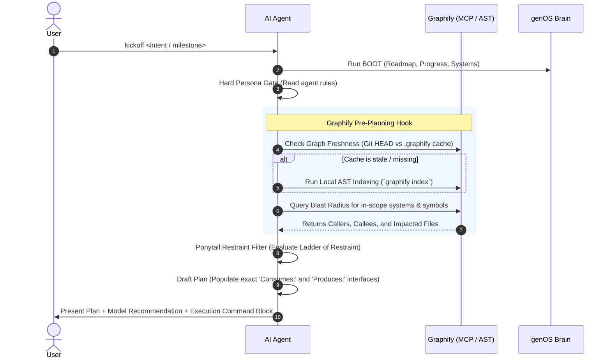

# Graphify Code Topology Integration Design

> **Document:** `docs/superpowers/specs/2026-11-10-graphify-code-topology-integration-design.md`  
> **Author:** Antigravity & User  
> **Date:** 2026-11-10  
> **Status:** Validated Design / Pending Plan Implementation  
> **Associated Milestone:** `M2` (genOS v3 Ergonomics & Superpowers Integration)

---

## 1. Executive Summary

As software projects scale over months and years, AI coding assistants face significant token overhead and latency when navigating sprawling codebases. While standard text search (`grep`, file globs) is effective for small projects, it requires multiple tool calls and exploratory reads to trace deep function call-hierarchies and calculate blast radius.

**Graphify** provides deterministic, local Abstract Syntax Tree (AST) parsing via Tree-sitter, transforming codebases into pre-mapped call graphs and dependency topologies.

This specification integrates Graphify into genOS as an optional, high-leverage **Code Navigation Sensor (MCP & Skill)** that plugs seamlessly into the pre-planning phase of `kickoff`. It provides agents with instant caller/callee lookups and blast-radius calculations without polluting the Project Brain or introducing mandatory external service dependencies.

---

## 2. Architectural Principles & Boundaries

1. **Semantic Truth vs. Implementation Truth (genOS Invariant):**
   - The genOS Project Brain (`brain/`) owns human intent, constraints, decisions, and roadmap criteria.
   - Graphify owns code syntax relationships and call trees (implementation truth).
   - **Zero Brain Contamination:** No Graphify AST caches or call trees are ever written into `brain/`.
2. **Graceful Degradation (Zero Dependency Lock-In):**
   - Graphify is an optional accelerator, not a hard requirement.
   - If Graphify is unconfigured or unavailable on a machine, genOS agents automatically and silently fall back to native file tools (`find_files`, `grep`, `read_file`) with zero workflow interruption.
3. **Local & Deterministic:**
   - Code parsing occurs locally via Tree-sitter. No source code or proprietary assets are sent to third-party graph clouds.
4. **Git Hygiene:**
   - Raw graph databases and caches (`.graphify/`) are strictly gitignored.
   - Curated architectural summaries may be emitted to `reports/architecture/GRAPH_REPORT.md`.

---

## 3. Directory Layout & Artifacts

```
d:\GameOS/
├── .agents/skills/graphify/
│   └── SKILL.md                 # Core agent skill: AST querying, caller mapping, blast-radius rules
├── .cursor/rules/
│   └── graphify.mdc             # Cursor IDE rule for Graphify MCP interactions
├── profiles/
│   ├── default/
│   │   └── mcp_template.json    # Standard profile MCP config with Graphify server
│   └── unity/
│       └── mcp_template.json    # Game dev / Unity profile with Graphify + UnityMCP
├── .graphify/                   # Local tree-sitter AST database & cache (GITIGNORED)
├── reports/architecture/        # Generated human-readable markdown summaries
│   └── GRAPH_REPORT.md          # Visual summary of modules, interfaces, and cross-system links
└── docs/superpowers/specs/
    └── 2026-11-10-graphify-code-topology-integration-design.md
```

---

## 4. Lifecycle Integration: The Kickoff Pre-Planning Hook

Graphify hooks into the genOS lifecycle specifically during the `kickoff` command, positioned between the **Hard Persona Gate** and the **Ponytail Restraint Filter**:



### Detailed Hook Steps:
1. **Freshness Verification:** The agent compares the timestamp of `.graphify/` against the latest git commit or file modification times. If stale or missing, it triggers local indexing.
2. **Blast-Radius Query:** For any file or function targeted by the active milestone, the agent queries Graphify's MCP tools:
   - `get_callers(symbol)`: Who depends on this component?
   - `get_dependencies(symbol)`: What does this component consume?
   - `get_blast_radius(path)`: Which test suites or neighboring systems will be impacted?
3. **Plan Interface Enrichment:** The agent uses the verified signatures returned by Graphify to fill out the implementation plan's `Task N: Interfaces` section:
   ```markdown
   **Interfaces:**
   - Consumes: [exact signatures verified from AST call graph]
   - Produces: [exact return types verified from AST call graph]
   ```

---

## 5. Skill Specification: `.agents/skills/graphify/SKILL.md`

The skill defines operational boundaries for AI agents:

### Invariants & Rules:
- **Never guess call hierarchies:** When Graphify is available, query the graph before asserting whether a method is safe to refactor or delete.
- **Always verify blast radius:** Before planning major file edits, inspect all direct and indirect callers.
- **Fallback to text tools:** If Graphify returns an error, empty result, or cannot parse a particular file type, fall back immediately to native file tools without halting the session.
- **Keep graph queries targeted:** Do not dump the entire global graph into the context window. Use symbol-specific queries (`get_callers`, `get_dependencies`).

---

## 6. Multi-IDE MCP Configuration Presets

Standardized configuration blocks are added to genOS's `profiles/`:

### Cursor (`.cursor/mcp.json`):
```json
{
  "mcpServers": {
    "graphify": {
      "command": "npx",
      "args": ["-y", "@graphify/mcp-server"]
    }
  }
}
```

### Claude Code / Claude Desktop (`claude_desktop_config.json`):
```json
{
  "mcpServers": {
    "graphify": {
      "command": "npx",
      "args": ["-y", "@graphify/mcp-server"]
    }
  }
}
```

### Antigravity (`agy` / custom MCP setup):
Configured through standard Antigravity MCP tool registration pointing to the local command or stdio bridge.

---

## 7. Error Handling & Edge Cases

| Scenario | Agent Behavior | Impact on Workflow |
|---|---|---|
| **Graphify not installed / no MCP configured** | Agent detects absence during pre-planning hook. | Silent fallback to native `grep` and `find_files`. Zero disruption. |
| **Unsupported file formats** (e.g. shaders, binary assets, YAML) | Graphify skips unparseable assets. | Agent uses engine-specific tools (e.g. Unity MCP) or native file reads. |
| **Corrupted or stale graph index** | Query fails with syntax/parser exception. | Agent attempts clean re-index (`graphify index --clean`). If failure persists, falls back to text search. |
| **New files created mid-milestone** | Files not yet in index. | Agent performs standard targeted file reads until next milestone index refresh. |

---

## 8. Verification & Acceptance Criteria

1. **Documentation Integrity:**
   - `.agents/skills/graphify/SKILL.md` created with clear agent instructions.
   - `.cursor/rules/graphify.mdc` created matching Cursor specifications.
   - `profiles/default/` and `profiles/unity/` updated with recommended MCP templates.
   - `.graphify/` added to `.gitignore`.
2. **Framework Alignment:**
   - `AGENTS.md` and `workflow-kickoff.md` updated to document the optional Pre-Planning Graphify Hook.
   - `brain/systems/Skills.md` updated to include `graphify` in the approved skills catalog.
   - `brain/30_DECISIONS.md` records `DEC-006: Graphify Code Topology Integration`.
3. **Doctor Sanity Gate:**
   - Running the genOS `doctor` command confirms 100% clean brain health.
