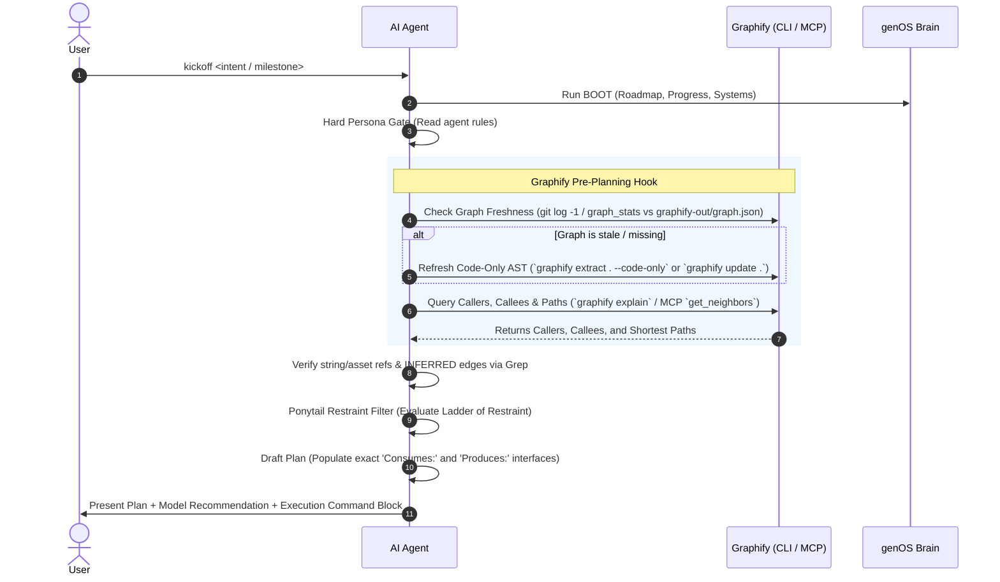

# Graphify Code Topology Integration Design

> **Document:** `docs/superpowers/specs/2026-11-10-graphify-code-topology-integration-design.md`  
> **Author:** Antigravity & User  
> **Date:** 2026-11-10  
> **Status:** Validated Design / Implemented (`M2`)  
> **Associated Milestone:** `M2` (genOS v3 Ergonomics & Superpowers Integration)

---

## 1. Executive Summary

As software projects scale over months and years, AI coding assistants face significant token overhead and latency when navigating sprawling codebases. While standard text search (`grep`, file globs) is effective for small projects, it requires multiple tool calls and exploratory reads to trace deep function call-hierarchies and calculate blast radius.

**Graphify** (PyPI `graphifyy[mcp]`) provides deterministic, local Abstract Syntax Tree (AST) parsing via Tree-sitter, transforming codebases into pre-mapped call graphs and dependency topologies (`graphify-out/graph.json`).

This specification integrates Graphify into genOS as an optional, high-leverage **Code Navigation Sensor (CLI + MCP & Skill)** that plugs seamlessly into the pre-planning phase of `kickoff`. It provides agents with instant caller/callee lookups and path analysis without polluting the Project Brain or introducing mandatory external service dependencies.

---

## 2. Architectural Principles & Boundaries

1. **Semantic Truth vs. Implementation Truth (genOS Invariant):**
   - The genOS Project Brain (`brain/`) owns human intent, constraints, decisions, and roadmap criteria.
   - Graphify owns code syntax relationships and call trees (implementation truth).
   - **Zero Brain Contamination:** No Graphify AST caches or call trees are ever written into `brain/`.
2. **Graceful Degradation (Zero Dependency Lock-In):**
   - Graphify is an optional accelerator, not a hard requirement.
   - If Graphify is unconfigured or unavailable on a machine, genOS agents automatically and silently fall back to native file tools (`find_files`, `grep`, `read_file`) with zero workflow interruption.
3. **Code Only, Local & Offline Privacy:**
   - Code parsing occurs strictly locally via Tree-sitter (`graphify extract . --code-only`). No API key is needed and nothing leaves the machine. Agents must never run document/image LLM extraction unless explicitly asked by the human.
4. **Syntactic Boundaries:**
   - Because the graph is syntactic, it cannot resolve references inside strings, scene/prefab files, menu paths, or reflection (`GameObject.Find`, `FindProperty`, `SendMessage`). Agents must still Grep for those and Grep-confirm `INFERRED` edges when decisions depend on them.
5. **Git Hygiene:**
   - Generated graph artifacts (`graphify-out/`, containing `graph.json`, `GRAPH_REPORT.md`, `graph.html`, and incremental `cache/`) are strictly gitignored.
   - Code indexing scope per repository is controlled via root `.graphifyignore`.

---

## 3. Directory Layout & Artifacts

```
d:\GameOS/
├── .agents/skills/graphify/
│   └── SKILL.md                 # Core agent skill: AST querying, caller/callee mapping, syntactic limits
├── .cursor/rules/
│   └── graphify.mdc             # Cursor IDE rule for Graphify CLI/MCP interactions
├── profiles/
│   ├── gamedev/profile.yaml     # Recommends graphify-mcp alongside Engine MCP
│   ├── web-fullstack/profile.yaml
│   ├── backend-services/profile.yaml
│   └── templates/
│       └── mcp-graphify.json    # Standard MCP config template (graphify-mcp --graph graphify-out/graph.json)
├── graphify-out/                # Local AST graph, cache & report (GITIGNORED in downstream repos)
│   ├── graph.json
│   ├── graph.html
│   └── GRAPH_REPORT.md
└── docs/superpowers/specs/
    └── 2026-11-10-graphify-code-topology-integration-design.md
```

---

## 4. Lifecycle Integration: The Kickoff Pre-Planning Hook

Graphify hooks into the genOS lifecycle specifically during the `kickoff` command, positioned between the **Hard Persona Gate** and the **Ponytail Restraint Filter**:



### Detailed Hook Steps:
1. **Freshness Verification:** The agent compares `graphify-out/graph.json` against `git log -1 --format=%cd` (or checks MCP `graph_stats` staleness). If stale or missing, it runs `graphify update .` (or initial `graphify extract . --code-only`).
2. **Topology Query (CLI or MCP):** For any class, method, or file targeted by the active milestone, the agent inspects its neighborhood:
   - **CLI:** `graphify explain "Class.Method()"` (callers `<--` and callees `-->`), `graphify path "A" "B"`, `graphify query "<question>" --seed X`
   - **MCP tools:** `query_graph`, `get_node`, `get_neighbors`, `shortest_path`, `get_community`, `god_nodes`, `graph_stats`
3. **Plan Interface Enrichment:** The agent Grep-verifies string/asset references and `INFERRED` edges, then populates the implementation plan's `Task N: Interfaces` section:
   ```markdown
   **Interfaces:**
   - Consumes: [signatures and callers from the graph, Grep-confirmed where INFERRED]
   - Produces: [return types and exported symbols]
   ```

---

## 5. Skill Specification: `.agents/skills/graphify/SKILL.md`

The skill defines operational boundaries for AI agents:

### Invariants & Rules:
- **Code only, local:** Build strictly with `--code-only` (`graphify extract . --code-only` / `graphify update .`). No LLM calls without explicit human instruction.
- **Never guess call hierarchies:** When Graphify is available, query the graph before asserting whether a method is safe to refactor or remove.
- **Syntactic limits & Grep confirmation:** Always Grep for string/asset/reflection references and Grep-confirm `INFERRED` edges when decisions depend on them.
- **Fallback to text tools:** If Graphify or `graphify-out/graph.json` is unavailable or fails, fall back immediately to `grep` and native file tools without halting the session.
- **Keep graph queries targeted:** Query one symbol or file at a time; never dump the global graph JSON into context.

---

## 6. Multi-IDE MCP Configuration Presets

Standardized configuration templates live in `profiles/templates/mcp-graphify.json`:

### Repo-Scoped MCP (Claude Code `.mcp.json` / Cursor `.cursor/mcp.json`):
```json
{
  "mcpServers": {
    "graphify": {
      "command": "graphify-mcp",
      "args": ["--graph", "graphify-out/graph.json"]
    }
  }
}
```
*(In environments launched outside the repo root such as Claude Desktop's Chat tab, use full executable and graph paths.)*

---

## 7. Error Handling & Edge Cases

| Scenario | Agent Behavior | Impact on Workflow |
|---|---|---|
| **Graphify not installed / no MCP configured** | Agent detects absence during pre-planning hook. | Silent fallback to native `grep` and `find_files`. Zero disruption. |
| **String/scene/prefab/reflection references** | Graphify syntactic AST omits runtime string lookups. | Agent runs targeted `grep` alongside graph queries. |
| **Stale or corrupted graph cache** | `graph_stats` warns stale or query fails. | Agent runs `graphify update .` (or `graphify extract . --code-only`); falls back to `grep` if errors persist. |
| **Unwanted directories (asset packs, builds, reports)** | Large non-code directories could bloat index. | Scoped via root `.graphifyignore` whitelist/exclusions. |

---

## 8. Verification & Acceptance Criteria

1. **Documentation & Template Integrity:**
   - `.agents/skills/graphify/SKILL.md` created with real `graphifyy` workflow and syntactic limits.
   - `.cursor/rules/graphify.mdc` created matching Cursor specifications.
   - `profiles/` updated with `graphify-mcp` recommendations and `profiles/templates/mcp-graphify.json`.
   - `graphify-out/` added to `.gitignore`.
2. **Framework Alignment:**
   - `AGENTS.md` and `workflow-kickoff.md` updated to document the optional Pre-Planning Code Topology Hook.
   - `brain/systems/Skills.md` updated to include `graphify` in the approved skills catalog.
   - `brain/30_DECISIONS.md` records `DEC-006: Graphify Code Topology Integration`.
3. **Doctor Sanity Gate:**
   - Running the genOS `doctor` command confirms 100% clean brain health.
