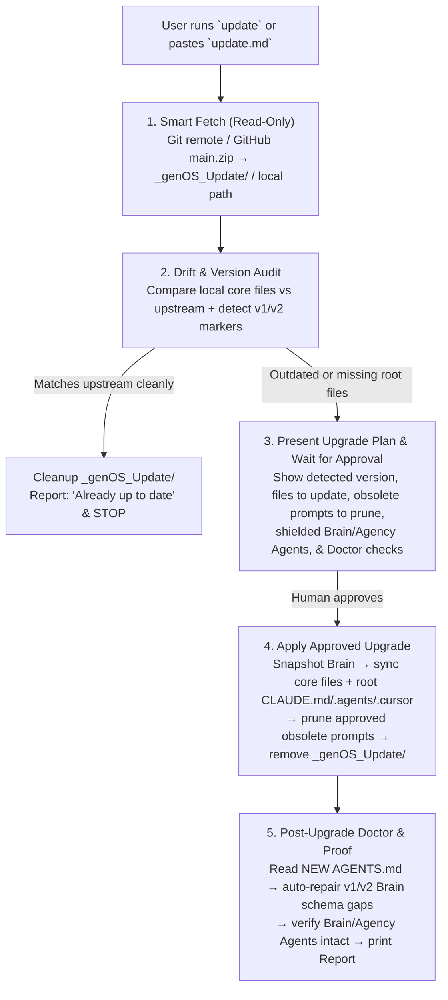

# Verify-First & Plan-Gated Framework Updater Design

> **Document:** `docs/superpowers/specs/2026-11-10-verify-plan-update-design.md`  
> **Author:** Antigravity & User  
> **Date:** 2026-11-10  
> **Status:** Approved Design / Implementing (`M2`)  
> **Associated Milestone:** `M2` (genOS v3 Ergonomics, Superpowers Integration & Self-Hosting)

---

## 1. Executive Summary

Currently, the genOS `update` command and [`guides/prompts/update.md`](file:///d:/GameOS/guides/prompts/update.md) immediately overwrite framework files without verifying whether the target installation is actually outdated, what version it is running, or whether legacy v1/v2 cleanup is required. Worse, when a user pastes `update.md` into a **legacy v1** project, the local v1 `AGENTS.md` lacks the v3 `update` and `doctor` auto-repair protocols, and obsolete v1/v2 prompts or nested `genOS/` root discovery files (`CLAUDE.md`, `.agents/`, `.cursor/`) are left unhandled.

This design makes `update` **Verify-First and Plan-Gated**—working reliably from day-one `v1`, `v2`, or outdated `v3` checkouts:
1. **Framework Version Marker:** Add `> **Framework Version:** 3.2` to `AGENTS.md` for instant generation/version identification.
2. **Self-Contained 5-Phase Upgrade Flow:** Verify drift first (short-circuit if already current), present an exact Upgrade & Migration Plan, wait for human approval, apply core updates safely, and finish with post-upgrade Doctor using the *newly fetched* `AGENTS.md`.

---

## 2. Architectural Principles & Boundaries

1. **Self-Contained on v1/v2 Targets:** Everything required for Phase 1–3 (`Smart Fetch`, `Verify Drift`, `Propose Plan`) lives directly inside `guides/prompts/update.md` without assuming the local repo already has new scripts or a v3 `AGENTS.md`.
2. **Always Verify Before Planning; Always Plan Before Writing:**
   - No local project or genOS file is modified during Phase 1 (Fetch) or Phase 2 (Drift Check).
   - If the target repo matches upstream `main` with zero drift, clean up temporary staging (`_genOS_Update/`) and stop cleanly.
3. **Strict Shielding During Sync:**
   - Never overwrite, modify, or delete `brain/`, `.obsidian/`, custom profiles in `profiles/`, project-installed Agency Agents in `.agents/skills/` or `.cursor/rules/`, or user source code.
   - Temporary Doctor schema repairs for legacy v1/v2 brains occur strictly in Phase 5 using the non-destructive auto-repair rules of the *upgraded* `AGENTS.md`.
4. **Root vs. Subdirectory Placement:** Automatically distinguish standalone repo-root genOS vs nested `genOS/` installs, ensuring `CLAUDE.md`, core `.agents/skills/`, and core `.cursor/rules/` reside at repository root.

---

## 3. Five-Phase Update Flow

### Generation & Drift Detection Signals (`Phase 2`)
An install is **outdated** (or needs migration) if ANY of the following hold:
- **Version header drift:** Local `AGENTS.md` lacks `> **Framework Version:**` (indicates `v1` or `v2`) or differs from upstream `AGENTS.md` version/content.
- **Obsolete v1/v2 prompts present:** Any of `setup-04-framework-upgrade.md`, `setup-tooling.md`, `setup-workforce.md`, `setup-obsidian-migration.md`, `workflow-01-kickoff.md`, `workflow-02-shutdown.md`, `workflow-03-resume-session.md`, `workflow-doctor.md`, `workflow-autonomous-batch.md` still exists in `guides/prompts/`.
- **Core file diff:** Any core file (`AGENTS.md`, `guides/guide.md`, `guides/scripts/install_agent.py`, canonical 5 files in `guides/prompts/`, standard `profiles/`, core `.agents/skills/` (`genos*`, `ponytail`, `graphify`, Superpowers), core `.cursor/rules/` (`genos*`, `ponytail`, `graphify`)) differs from upstream or is missing.
- **Repo-root bootstrapping gap:** Missing `CLAUDE.md` at repository root, or `.agents/` / `.cursor/` missing at repository root when `genOS/` is nested.

*(Note: In upstream `d:\GameOS` itself or a repo without upstream diffs, `brain/` is always excluded from core diffing so project-owned or self-hosted brains are never flagged as "drift".)*

---

## 4. Files Touched

| File | Update |
|---|---|
| `AGENTS.md` | Add `> **Framework Version:** 3.2`; update `Commands -> update`; upgrade `## Framework Update Protocol` to the 5-phase Verify -> Plan -> Approve -> Apply -> Doctor workflow. |
| `guides/prompts/update.md` | Rewrite as a self-contained 5-phase prompt working natively on legacy `v1`/`v2` and outdated `v3` projects. |
| `.agents/skills/genos-update/SKILL.md` | Align skill trigger description with Verify -> Plan -> Approve -> Apply -> Doctor. |
| `.cursor/rules/genos-update.mdc` | Align Cursor rule summary with Verify -> Plan -> Approve -> Apply -> Doctor. |
| `brain/systems/Updater.md` | Document Verify-First drift detection, Plan-Gated approval, and v1/v2 legacy migration invariants (`[[DEC-008]]`). |
| `README.md` & `guides/guide.md` | Update `update` summary row and maintenance notes to reflect verify-before-update & plan approval. |
| `brain/30_DECISIONS.md` | Record `DEC-008: Verify-First & Plan-Gated Framework Updater` (Index + entry). |
| `brain/50_ROADMAP.md` & `brain/20_PROGRESS.yaml` | Add `[[DEC-008]]` to `M2` deliverables and update `session_summary`. |

---

## 5. Acceptance Criteria

1. `AGENTS.md` contains the version marker `> **Framework Version:** 3.2` and the complete 5-phase `Framework Update Protocol`.
2. `guides/prompts/update.md` is self-contained (lists exact canonical vs obsolete v1/v2 prompt filenames, exact core skill/rule names, exact strict shields, and instructs reading the newly fetched `AGENTS.md` before running Doctor).
3. Supporting skill, rule, README, guide, and `brain/` docs match 100% with zero conflicting rules.
4. Existing unit tests (`python -m unittest discover -s guides/scripts -p "test_*.py" -v`) and Doctor audit (`8/8`) pass cleanly.
